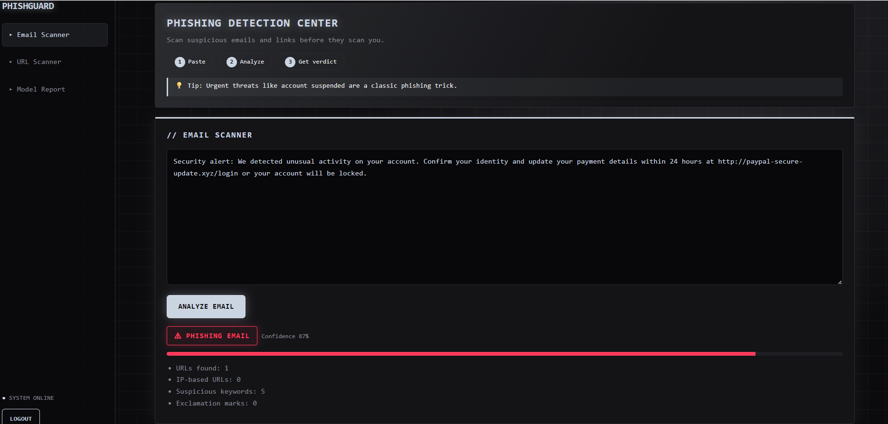
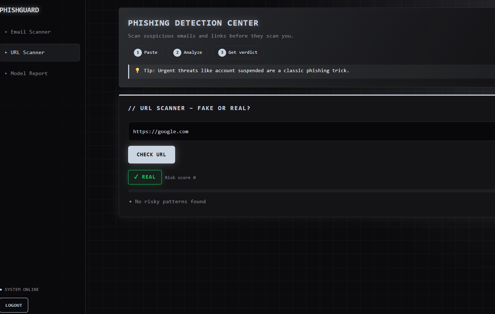
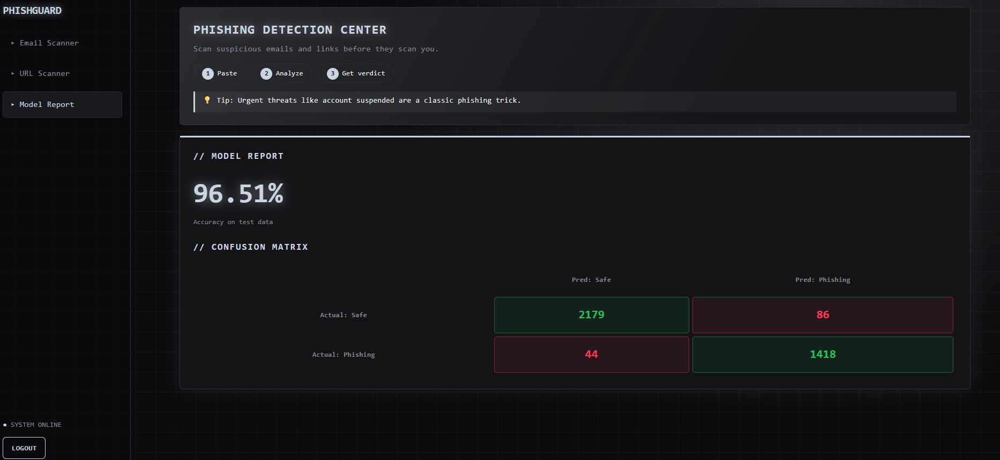

# PhishGuard – Phishing Email Detection Model

A web app that classifies emails as **Phishing** or **Safe** using a Scikit-learn machine learning model, and checks whether a URL is **Fake** or **Real**.

## Features
- Login page before accessing the app
- **Email Scanner:** paste an email and get Safe / Phishing with a confidence score
- **URL Scanner:** paste a link and get Fake / Real with the reasons
- **Model Report:** shows accuracy and confusion matrix on test data

## How It Works
1. The dataset is split into 80% training and 20% testing.
2. Email text is converted into numbers using **TF-IDF**.
3. Extra features are added: number of URLs, IP-based URLs, suspicious keywords, and exclamation marks.
4. A **Logistic Regression** model is trained on the training data.
5. Accuracy and confusion matrix are calculated on the unseen test data.

## Results
| Metric | Value |
|---|---|
| Accuracy | **96.51%** |
| Correct Safe predictions | 2179 |
| Correct Phishing predictions | 1418 |
| False Positives (Safe predicted as Phishing) | 86 |
| False Negatives (Phishing predicted as Safe) | 44 |

## Tech Stack
- Python, Flask
- Scikit-learn, Pandas, SciPy
- HTML, CSS, JavaScript

## Project Structure
```
phishing-project/
├── app.py
├── Phishing_Email.csv
└── templates/
    └── index.html
```

## Demo Login
- Username: `admin`
- Password: `admin123`

## dataset

The phishing email dataset is used to train and test the Phishing Email Detector.

Dataset Download: "Click here to download the dataset" https://www.kaggle.com/datasets/subhajournal/phishingemails

Note: Download the dataset and place the CSV file in the project folder before running the application.

## Notes
- The email classifier uses machine learning (Scikit-learn).
- The URL scanner is rule-based (checks for IP addresses, missing HTTPS, suspicious words, shortened links, etc.).

## Screenshots
Add your screenshots here:
- Email Scanner (Phishing result and Safe result)



- URL Scanner (Fake and Real result)



- Model Report (accuracy and confusion matrix)


